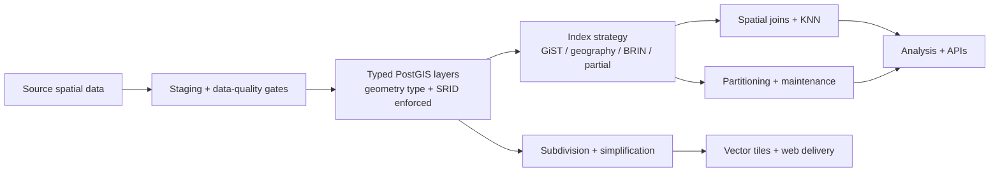

# postgis-cookbook — Production PostGIS Patterns & Best Practices for PostgreSQL


<!-- ZQM-START -->
<!-- markdownlint-disable MD033 -->
<p align="center">
  <strong>ZQM Computing — Geospatial Engineering & Scientific Computing</strong><br>
  <a href="https://github.com/ZQM-Computing">ZQM Computing</a> •
  <a href="https://github.com/ZQM-Labs">ZQM Labs</a>
</p>
<!-- markdownlint-enable MD033 -->
<!-- ZQM-END -->

[](https://github.com/ZQM-Computing/postgis-cookbook/actions)

Production-minded PostGIS patterns for people who build and operate spatial databases — not just query them once. A runnable cookbook of spatial SQL recipes covering **spatial indexing (GiST, SP-GiST, BRIN, partial indexes)**, **spatial joins and nearest-neighbor (KNN) queries**, **coordinate reference systems and SRID management**, **vector tiling with `ST_AsMVT`**, **geometry data-quality checks**, and **table partitioning and maintenance**.

The examples use a small, synthetic dataset shaped like a Florida county: service areas, sites, parcels, and sensor observations. Every pattern answers a practical question, runs against the sample data, and calls out the trade-off or anti-pattern that matters in production.

**Who this is for:** GIS analysts moving into spatial database work, backend and data engineers adding geospatial queries to PostgreSQL, and geospatial architects who need defensible, production-tested patterns instead of one-off snippets. Think of it as a PostGIS tutorial you can actually run — every example executes end-to-end against the included Docker demo and is verified by CI.

## Repository role and status

**Status:** Active, public.

**What this repository is:** Production PostGIS patterns — a runnable cookbook of spatial SQL covering GiST/SP-GiST/BRIN indexing, spatial joins and nearest-neighbor (KNN) queries, CRS and SRID management, and vector-tile generation.

**What it contributes:** Part of the ZQM Computing public geospatial portfolio — production-grade pattern and reference repositories that document geospatial engineering practice across the stack. This repository is the reusable pattern library for its layer: working code and runbooks that practitioners can lift into their own pipelines, and portfolio evidence of the engineering practice behind ZQM Computing. The umbrella index for the series is [geospatial-cookbooks](https://github.com/ZQM-Computing/geospatial-cookbooks).

**Standing:** The portfolio program was completed and Tier-1 hardened on 2026-10-15, with prose CI enforced as required status checks. This repository is standalone — no other repository or deployment depends on it.

## Patterns

| Pattern | Question it answers | File |
|---|---|---|
| Indexing | Which index belongs on this geometry or timestamp? | [`patterns/01_indexing.sql`](patterns/01_indexing.sql) |
| Spatial joins | How do I join, filter by distance, and find nearest neighbors efficiently? | [`patterns/02_spatial_joins.sql`](patterns/02_spatial_joins.sql) |
| Coordinate systems | When should I use geometry, geography, or a projected CRS? | [`patterns/03_coordinate_systems.sql`](patterns/03_coordinate_systems.sql) |
| Tiling and simplification | How do I prepare polygons for fast web delivery? | [`patterns/04_tiling_and_simplification.sql`](patterns/04_tiling_and_simplification.sql) |
| Data quality | How do I find invalid, duplicate, empty, or mixed-SRID data? | [`patterns/05_data_quality.sql`](patterns/05_data_quality.sql) |
| Partitioning and maintenance | How do I keep a growing spatial table observable and manageable? | [`patterns/06_partitioning_and_maintenance.sql`](patterns/06_partitioning_and_maintenance.sql) |

Read [`docs/pattern-guide.md`](docs/pattern-guide.md) for the decision rules behind the SQL, [`docs/production-runbook.md`](docs/production-runbook.md) for ingestion, query-plan, migration, security, and recovery checklists, and [`scripts/benchmark_queries.sql`](scripts/benchmark_queries.sql) for a read-only query-plan inspection harness.

## How the patterns fit together



The operating model is deliberate: validate before promotion, enforce coordinate semantics in the schema, index for the predicates the application actually runs, and simplify only at the delivery boundary.

## Quick start

Requirements: Docker Engine or Docker Desktop with Compose v2. Make is optional.

```bash
git clone https://github.com/ZQM-Computing/postgis-cookbook.git
cd postgis-cookbook
docker compose up -d db
bash scripts/run_examples.sh
```

The runner waits for PostgreSQL, creates the extensions and sample data, executes every pattern, and finishes with smoke-test assertions. CI then executes the read-only `EXPLAIN (ANALYZE, BUFFERS)` benchmark harness to catch query regressions and syntax/runtime errors; the tiny fixture is not a performance benchmark.

Useful commands:

```bash
make psql       # open psql in the demo database
make validate   # rerun the full example + assertion suite
make reset      # remove the demo volume and rebuild from scratch
make down       # stop the database, keeping the volume
```

If Make is unavailable, use `docker compose` directly and run the SQL files in the order listed under [Manual run](#manual-run).

## Manual run

```bash
docker compose up -d db
bash scripts/wait_for_db.sh

docker compose exec -T db psql -U patterns -d postgis_patterns -v ON_ERROR_STOP=1 < sql/00_extensions_and_schema.sql
docker compose exec -T db psql -U patterns -d postgis_patterns -v ON_ERROR_STOP=1 < sql/01_sample_data.sql
docker compose exec -T db psql -U patterns -d postgis_patterns -v ON_ERROR_STOP=1 < patterns/01_indexing.sql
# Continue with patterns 02–06, then tests/assertions.sql.
```

## Design principles

1. **Store coordinates deliberately.** The examples store longitude/latitude as `geometry(..., 4326)`, use `geography` for meter-based distance and area, and transform to Florida State Plane East (EPSG:2236) when a projected measurement is the point.
2. **Let the index participate.** Predicates are written so PostgreSQL can use spatial indexes — `ST_DWithin` instead of filtering on a computed `ST_Distance`, and no unnecessary transform wrapped around the indexed column.
3. **Prefer boring, observable SQL.** Each example names its output columns, shows the plan-reading hook in comments, and avoids hiding the important operation inside a framework.
4. **Separate the demo from the decision.** Synthetic data makes the patterns runnable; the guide explains when the same choice would — or would not — scale to millions of rows.

## Repository layout

```text
.
├── docs/pattern-guide.md      # decision rules, anti-patterns, production checklist
├── docs/production-runbook.md # ingest QA, plan review, security, recovery
├── scripts/benchmark_queries.sql # repeatable EXPLAIN ANALYZE harness
├── sql/                       # extensions, schema, and deterministic sample data
├── patterns/                  # numbered, runnable pattern files
├── scripts/                   # database wait + full-suite runner
├── tests/assertions.sql       # smoke tests for the demo dataset and patterns
├── docker-compose.yml         # local PostGIS 3.4 / PostgreSQL 16
└── Makefile                   # up, psql, validate, reset, down
```

## Production notes

- Pin the PostGIS and PostgreSQL versions in real deployments; spatial function behavior and planner statistics are part of your platform contract.
- Build large production indexes with `CREATE INDEX CONCURRENTLY` through a migration process that can tolerate its transaction rules. The demo uses ordinary index creation so the files stay runnable as a suite.
- Re-run `ANALYZE` after bulk loads and before judging a query plan.
- Treat geometry validity, SRID consistency, and backup/restore testing as operational requirements, not cleanup tasks.
- Benchmark with representative data volume and distributions. A pattern that wins on 24 parcels can lose on 24 million.

## Data note

All features are synthetic. Coordinates fall around Volusia County, Florida so the projected-CRS examples are geographically sensible, but the parcels, sites, service areas, and observations do not represent real property, infrastructure, or people.

## Contributing

Issues and pull requests are welcome — especially patterns with a runnable example, the production problem it solves, and the trade-off it makes. Please keep examples deterministic and free of real parcel, utility, customer, or otherwise sensitive data. See [`CONTRIBUTING.md`](https://github.com/ZQM-Computing/postgis-cookbook/blob/main/CONTRIBUTING.md).

## Maintainer

Maintained by [ZQM Computing](https://github.com/ZQM-Computing). Patterns distilled from production geospatial platform and spatial data engineering work by Alex Zelenski, GISP.

## Related repositories

- [duckdb-spatial-cookbook](https://github.com/ZQM-Computing/duckdb-spatial-cookbook) — DuckDB Spatial patterns for analytical geospatial SQL: GeoParquet, spatial joins, KNN, H3 aggregation — no server required
- [pgrouting-cookbook](https://github.com/ZQM-Computing/pgrouting-cookbook) — pgRouting network analysis on PostGIS: shortest path, driving distance, isochrones, turn restrictions, traffic-aware routing
- [geopandas-cookbook](https://github.com/ZQM-Computing/geopandas-cookbook) — GeoPandas/Shapely patterns for Python geospatial workflows: spatial joins, CRS handling, overlays, interpolation, performance
- [gdal-cookbook](https://github.com/ZQM-Computing/gdal-cookbook) — GDAL/OGR command-line patterns: conversion, reprojection, clipping, mosaicking — production-tested, runnable examples
- [stac-cookbook](https://github.com/ZQM-Computing/stac-cookbook) — STAC patterns for geospatial data discovery: catalogs, item validation, search API, bulk operations, cloud deployment
- [maplibre-cookbook](https://github.com/ZQM-Computing/maplibre-cookbook) — MapLibre GL JS patterns for frontend vector tile rendering: custom layers, 3D terrain, performance tuning, interactive maps
- [cog-cookbook](https://github.com/ZQM-Computing/cog-cookbook) — Cloud Optimized GeoTIFF patterns: creation, validation, TiTiler serving, xarray integration, performance benchmarking
- [geoparquet-cookbook](https://github.com/ZQM-Computing/geoparquet-cookbook) — GeoParquet patterns for columnar geospatial analytics: partitioning, predicate pushdown, DuckDB/Spark integration
- [h3-cookbook](https://github.com/ZQM-Computing/h3-cookbook) — H3 hexagonal grid patterns: indexing, aggregation, visualization, grid comparisons, performance benchmarks
- [qgis-resources](https://github.com/ZQM-Computing/qgis-resources) — QGIS expressions, PyQGIS snippets, Processing scripts, styles, and QField field-collection guides
- [geospatial-api-reference](https://github.com/ZQM-Computing/geospatial-api-reference) — OGC API – Features reference implementation with FastAPI and PostGIS backends
- [ollama-fleet-patterns](https://github.com/ZQM-Computing/ollama-fleet-patterns) — Ollama fleet operations: model management, health checks, load-spreading, VRAM budgeting, dependency-light RAG
- [proxmox-ceph-operations](https://github.com/ZQM-Computing/proxmox-ceph-operations) — Proxmox VE + Ceph operations runbooks: health checks, backup discipline, OSD replacement, upgrade checklists
- [geospatial-cookbooks](https://github.com/ZQM-Computing/geospatial-cookbooks) — Umbrella index for all ZQM geospatial pattern repos

## Documentation and validation

For setup instructions, reproducible examples, data provenance, CRS/SRID assumptions, security guidance, and dependency labels, follow the [ZQM geospatial repository documentation standard](https://github.com/ZQM-Computing/geospatial-cookbooks/blob/main/docs/repository-documentation-standard.md).

The configured CI workflow is the source of truth for automated checks. A passing workflow establishes only that its checks passed for that commit; it does not certify production deployment or prove that every dependency and operating environment was covered.

## Installation

No package to install — the runnable examples run against the demo database in Docker:

```bash
docker compose up -d db
```

The Makefile documents the main workflows: `make validate` reruns the full example + assertion suite, `make psql` opens psql in the demo database, `make reset` rebuilds the demo from scratch, and `make down` stops the database.

Requires Docker Engine with Compose v2.

## License

MIT — see [`LICENSE`](https://github.com/ZQM-Computing/postgis-cookbook/blob/main/LICENSE).

*Part of [ZQM Computing](https://github.com/ZQM-Computing) — geospatial engineering, scientific computing, and infrastructure patterns; the geospatial arm of [ZQM Labs](https://zqmlabs.com), makers of Z's Quests & Mischief location games.*

<!-- ZQM-FOOTER-START -->
<!-- markdownlint-disable MD033 -->
---

<p align="center">
  <em>Play more. Plan less.</em><br>
  <a href="https://zqmlabs.com">zqmlabs.com</a> •
  <a href="https://github.com/ZQM-Labs">ZQM Labs</a> •
  <a href="https://github.com/ZQM-Computing">ZQM Computing</a>
</p>
<!-- markdownlint-enable MD033 -->
<!-- ZQM-FOOTER-END -->
